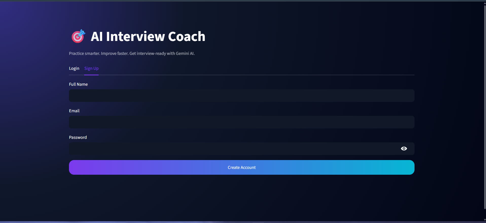
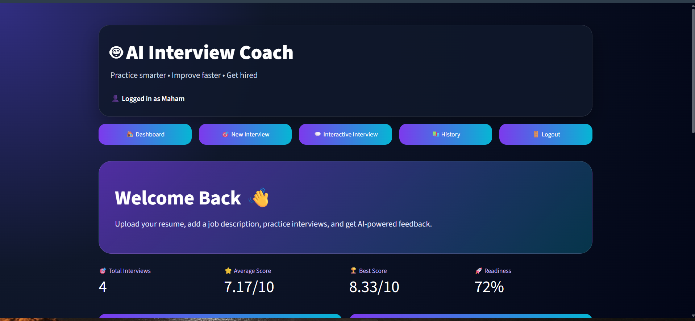
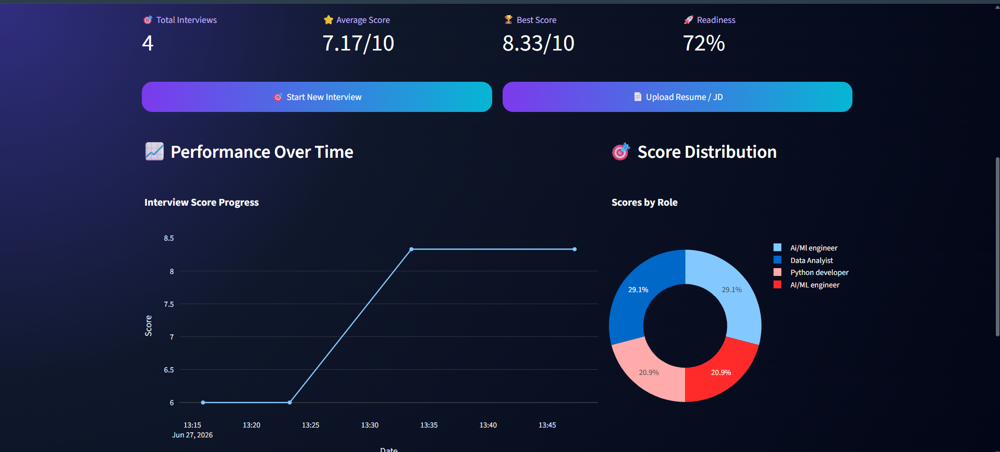
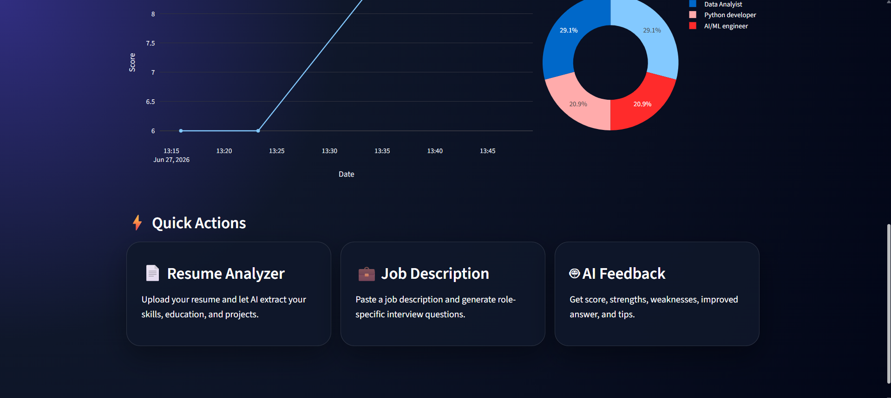
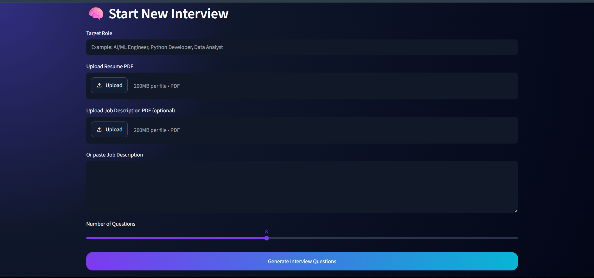
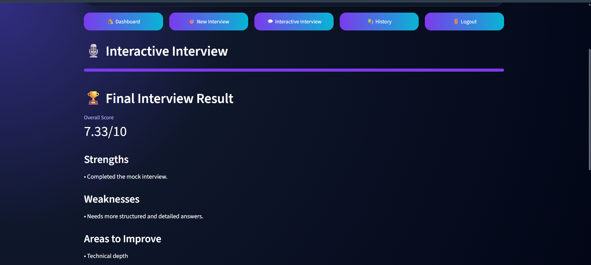
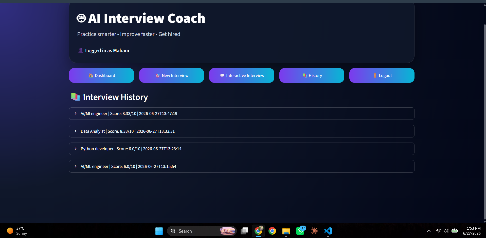

# 🤖 AI Interview Coach

### AI-Powered Mock Interview Preparation Platform using Google Gemini, Streamlit, Resume Parsing, SQLite & Intelligent Feedback Analysis


---

### 🔗 Project Deliverables & Links
- **🚀 Live Prototype:** [https://ai-mock-interview-aryan.streamlit.app](https://ai-mock-interview-aryan.streamlit.app)
- **🎬 Demo Reel Video:** [YouTube Video (144 seconds)](https://www.youtube.com/watch?v=CfZJnrH0RxE)
- **📂 GitHub Repository:** [https://github.com/Aryan-yd/ai-mock-interview](https://github.com/Aryan-yd/ai-mock-interview)
- **📑 Milestone 2 Submission PDF:** [`docs/M2_PE-B81-22_AIInterviewCoach.pdf`](docs/M2_PE-B81-22_AIInterviewCoach.pdf)
- **📄 Supporting Technical Report:** [`reports/Technocrats_TechnicalReport.pdf`](reports/Technocrats_TechnicalReport.pdf)

---

# 📖 Overview

**AI Interview Coach** is an intelligent interview preparation platform designed to help candidates practice interviews using **Generative AI**.

The system allows users to upload a resume, provide a job description, generate personalized interview questions, answer questions interactively, receive AI-powered evaluation, track progress, and download a professional PDF report.

Instead of giving generic interview questions, AI Interview Coach uses the candidate’s resume, target role, and job description to generate relevant questions and evaluate answers based on real interview criteria.

---

# ✨ Features

## 🔐 User Authentication

- User Sign Up
- User Login
- Session-based access
- Personal interview records
- SQLite-backed user data storage

---

## 📄 Resume Upload & Parsing

Users can upload a resume in PDF format.

The system extracts resume text and uses AI to identify:

- Skills
- Education
- Projects
- Experience
- Resume Summary

---

## 💼 Job Description Input

Users can provide a job description by:

- Uploading a PDF job description
- Pasting job description text manually

The job description helps the AI generate role-specific questions.

---

## 🧠 AI Question Generation

Google Gemini generates personalized interview questions based on:

- Resume content
- Job description
- Target role
- Candidate background

Question categories include:

- HR Questions
- Technical Questions
- Behavioral Questions
- Project-based Questions
- Coding Questions

---

## 🎙️ Interactive Interview Mode

The platform displays one question at a time.

The user submits an answer, and AI evaluates it instantly.

This creates a realistic mock interview experience.

---

## 📊 AI Answer Evaluation

Each answer is evaluated using multiple criteria:

- Correctness
- Confidence
- Completeness
- Communication
- Technical Depth
- Overall Score

The AI provides:

- Strengths
- Weaknesses
- Improved Answer
- Practical Tips

---

## 📈 Dashboard

The dashboard displays:

- Total Interviews
- Average Score
- Best Score
- Interview Readiness
- Score Progress
- Score Distribution

Interactive charts are built using **Plotly**.

---

## 📚 Interview History

Users can view previous interview sessions including:

- Target Role
- Final Score
- Questions
- Answers
- AI Feedback
- Date of Interview

---

## 📄 PDF Report Generation

After completing an interview, users can download a PDF report containing:

- Candidate Name
- Target Role
- Overall Score
- Questions
- User Answers
- AI Feedback
- Strengths
- Weaknesses
- Areas for Improvement
- Final Tips

---

# 🏗️ System Architecture

```text
User Login / Signup
        │
        ▼
Resume Upload + Job Description
        │
        ▼
PDF Text Extraction
        │
        ▼
Google Gemini API
        │
        ▼
AI Question Generation
        │
        ▼
Interactive Interview
        │
        ▼
AI Answer Evaluation
        │
        ▼
SQLite Database
        │
        ▼
Dashboard + History + PDF Report
```

---

# 🛠️ Tech Stack

| Category | Technology |
|----------|------------|
| Language | Python 3.11+ |
| Frontend | Streamlit |
| LLM | Google Gemini |
| Database | SQLite |
| Resume Parsing | PDF Text Extraction |
| Charts | Plotly |
| Reports | FPDF |
| Environment Variables | Python Dotenv |
| Data Handling | Pandas |

---

# 📂 Project Structure

```text
AI-Interview-Coach/
│
├── app.py
├── login.py
├── interview.py
├── feedback.py
├── gemini.py
├── database.py
├── pdf_reader.py
├── report_generator.py
├── requirements.txt
├── README.md
├── .env.example
├── .gitignore
│
├── reports/
│   └── generated interview reports
│
├── database/
│   └── local sqlite database
│
└── assets/
    └── screenshots and images
```

---

# ⚙️ Installation

## Clone Repository

```bash
git clone https://github.com/YOUR_USERNAME/AI-Interview-Coach.git
cd AI-Interview-Coach
```

---

## Create Virtual Environment

### Windows

```bash
py -3.11 -m venv venv
venv\Scripts\activate
```

### Linux / macOS

```bash
python3 -m venv venv
source venv/bin/activate
```

---

## Install Dependencies

```bash
pip install -r requirements.txt
```

---

# 🔑 Configure Environment Variables

Create a `.env` file in the root directory.

```env
GEMINI_API_KEY=YOUR_GEMINI_API_KEY
```

You can get a Gemini API key from Google AI Studio.

---

# ▶️ Run the Application

```bash
streamlit run app.py
```

Then open the local URL shown in the terminal.

---

# 💡 How It Works

```text
1. User signs up or logs in
2. User enters target job role
3. User uploads resume
4. User adds job description
5. Gemini generates interview questions
6. User answers questions one by one
7. Gemini evaluates each answer
8. Final feedback is generated
9. Interview is saved in SQLite
10. User downloads PDF report
```

---

# 🧪 Example Use Cases

- AI Mock Interview Practice
- Resume-based Interview Preparation
- Job Description-based Interview Questions
- HR Interview Practice
- Technical Interview Practice
- Behavioral Interview Practice
- Final-year Student Portfolio Project
- AI/ML Internship Preparation
- Career Readiness Tool

---

# 📊 Evaluation Metrics

The AI evaluates candidate answers using:

| Metric | Description |
|--------|-------------|
| Correctness | Checks whether the answer is accurate |
| Confidence | Measures clarity and certainty |
| Completeness | Checks if the answer fully addresses the question |
| Communication | Evaluates explanation quality |
| Technical Depth | Measures technical understanding |
| Overall Score | Final score out of 10 |

---

# 📸 Application Screenshots


## 🎯 SignUp page



## 🏠 Dashboard





## 🎯 Interview Setup



## 🎙️ Interactive Interview



## 📄 History



---

# 🚀 Future Improvements

- Voice-based interview mode
- Speech-to-text answer input
- AI voice interviewer
- Resume ATS score checker
- Company-specific interview mode
- Coding interview mode
- Live code editor
- Webcam confidence analysis
- Email report delivery
- Streamlit Cloud deployment
- Admin dashboard
- Multi-user analytics

---

# 🧠 Skills Demonstrated

This project demonstrates practical skills in:

- Generative AI
- Large Language Models
- Prompt Engineering
- Google Gemini API Integration
- Python Backend Development
- Streamlit UI Development
- SQLite Database Design
- Resume Parsing
- PDF Processing
- AI Evaluation Systems
- Data Visualization
- PDF Report Generation
- Authentication Systems
- Full-stack AI Application Development


# ⭐ Support

If you found this project useful, consider giving it a ⭐ on GitHub.
